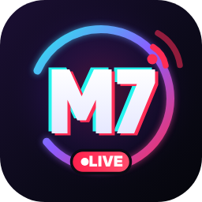
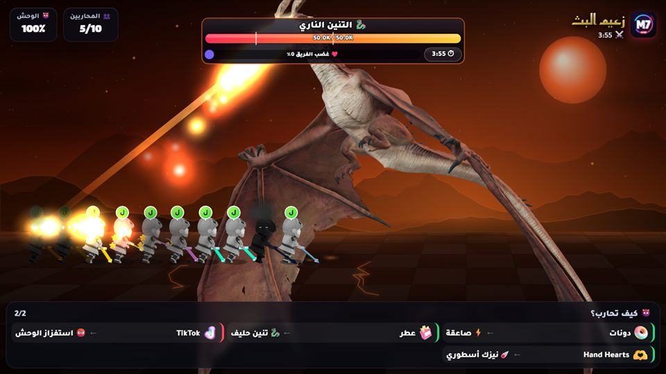
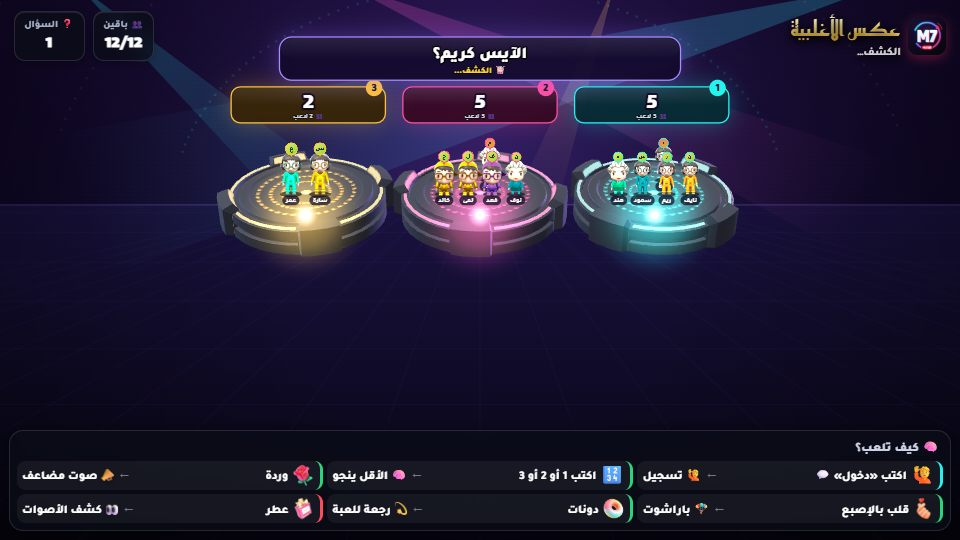
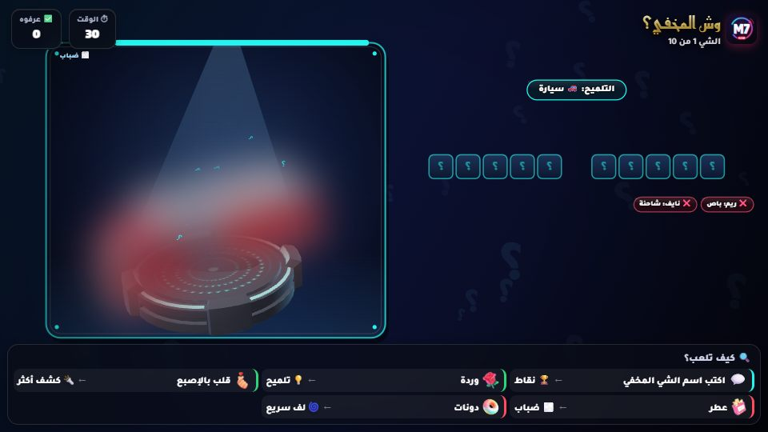
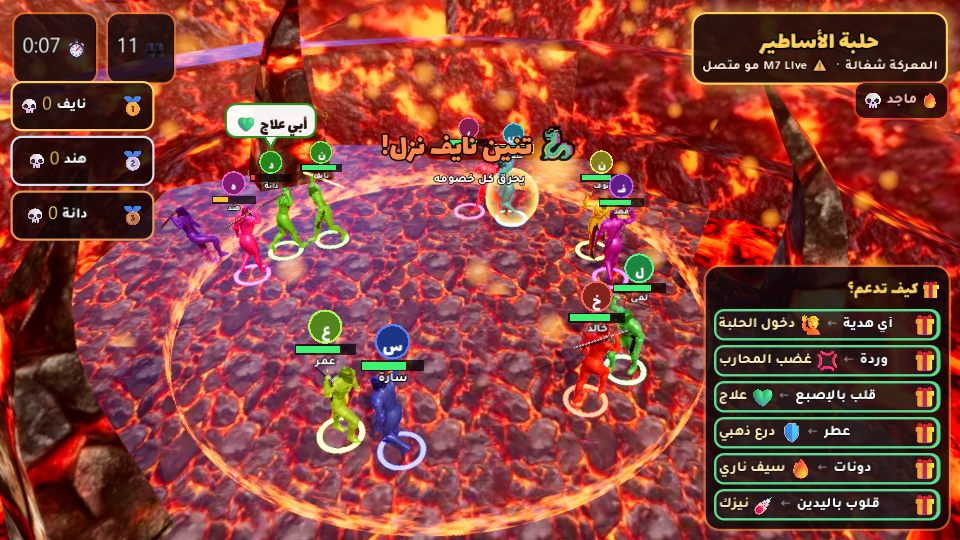
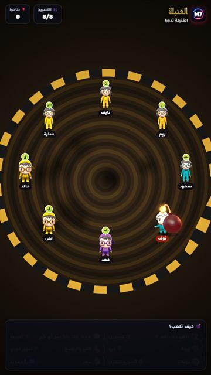
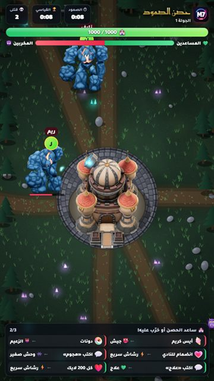
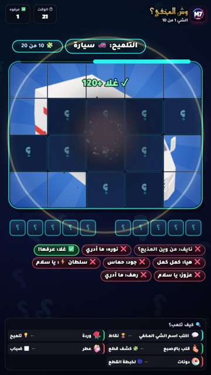
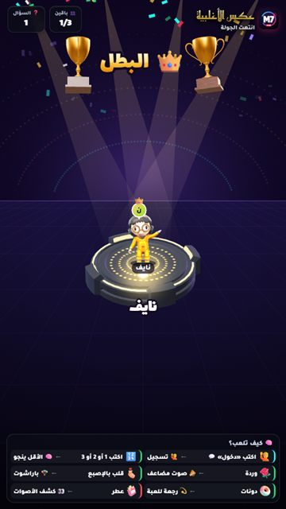

# M7 Live

**ألعاب 3D تفاعلية لبث تيك توك المباشر — المتابعين يلعبون بالهدايا والتعليقات واللايكات**

### [⬇️ حمّل آخر نسخة](https://github.com/madomiz11/m7-live/releases/latest)

## 🎯 وش هو M7 Live؟
برنامج ويندوز يربط بثك في تيك توك بألعاب **3D** تشتغل على شاشتك. كل هدية أو تعليق أو لايك من المتابعين يسوي شي داخل اللعبة. **أنت تختار** وش تسوي كل هدية، والمتابعين يتحمسون لأنهم يشوفون دعمهم يغيّر اللعبة قدامهم.

## 🚀 ابدأ في 4 خطوات
1. **حمّل** ملف `M7Live-Setup` من [آخر نسخة](https://github.com/madomiz11/m7-live/releases/latest) وثبّته.
2. **اكتب يوزرك** في تيك توك داخل البرنامج واضغط «اتصال» (لازم تكون فاتح بث).
3. **اختار لعبة** من القائمة، وحدد من «القواعد» وش تسوي كل هدية.
4. **صوّر نافذة اللعبة** في TikTok LIVE Studio أو OBS، وابدأ!

> 💡 تبي تجرب قبل البث؟ شغّل **وضع التجربة** من البرنامج، ويطلع لك متابعين وهدايا وهمية.

## 🎮 الألعاب

<table>
<tr>
<td width="50%"> <b>🧠 عكس الأغلبية</b> — اختار الخيار اللي تتوقع إن أقل ناس بيختارونه</td>
<td width="50%"> <b>🔍 وش المخفي؟</b> — مجسم 3D ينكشف شوي شوي، وأول واحد يعرفه يفوز</td>
</tr>
</table>

### 💬 ألعاب الشات (يلعبونها بالتعليقات)
| | اللعبة | كيف يلعبون |
|:-:|---|---|
| 🧠 | **عكس الأغلبية** | يكتبون 1 أو 2 أو 3، واللي مع الأغلبية تطيح منصتهم |
| 🔍 | **وش المخفي؟** | يكتبون اسم الشي المخفي، وكل ما عرفوه بدري أخذوا نقاط أكثر |
| 🔤 | **حروف** | الكاوبوي يصيد لاعب، ويجاوب: إنسان، حيوان، نبات، جماد، بلاد |
| 🪑 | **الكراسي الموسيقية** | توقف الموسيقى، ويكتبون رقم الكرسي بسرعة |
| ❓ | **سؤال وجواب** | مسابقة ثقافية، يكتبون رقم الجواب والأسرع ياخذ أكثر |
| 🔀 | **رتّب الحروف** | الحروف ملخبطة، وأول واحد يكتبها صح يفوز |
| 💣 | **القنبلة** | اللي معه القنبلة يعلّق عشان يمررها قبل ما تنفجر |

### 🎁 ألعاب الدعم (الهدايا تقرر)
| | اللعبة | كيف يلعبون |
|:-:|---|---|
| 👹 | **زعيم البث** | كل المتابعين فرسان ضد تنين أو عملاق 3D، والهدايا ضربات وقوى |
| 🏰 | **حصن الصمود** | قلعة 3D يدافع عنها مدفع، والهدايا تساعد الحصن أو ترسل له وحوش |
| 👑 | **عرش أكبر داعم** | أكبر داعم يجلس على العرش لين أحد يطيّحه بهدية أكبر |
| 🏁 | **سباق المتابعين** | اللايكات والهدايا تسرّع متسابقك للخط |
| 🪢 | **حرب الفريقين** | فريقين يسحبون الحبل بالهدايا واللايكات |
| ⚔️ | **ساحة القتال** | كل متابع مقاتل بصورته، وآخر واحد يبقى هو البطل |

### 🔥 قريباً: حلبة الأساطير

معركة 3D احترافية مصنوعة بمحرك **Godot**: كل داعم فارس، والحلبة تضيق بحلقة نار، وآخر فارس يطير على التنين ويصير له **تمثال ذهبي**.

## ✨ مميزات البرنامج

<table>
<tr>
<td width="33%" valign="top">

**🎁 تحكم كامل بالهدايا**
- أي هدية لأي قوة في اللعبة
- أو تعليق، لايك، متابعة، مشاركة
- صور كل هدايا تيك توك
- يحسب الكومبو صح

</td>
<td width="33%" valign="top">

**🏅 نقاط ومستويات**
- نقاط دائمة لكل متابع
- ألقاب من «مبتدئ» لين «ملك البث»
- إطار صورة متحرك لكل مستوى
- ترتيب أسبوعي وشهري

</td>
<td width="33%" valign="top">

**🎨 عروض للبث**
- توب الداعمين بـ 6 تصاميم
- شريط الهدف وآخر هدية
- دليل هدايا بالسحب والإفلات
- قوائم متنقلة تلقائية

</td>
</tr>
<tr>
<td valign="top">

**🛒 متجر النقاط**
- المتابع يصرف نقاطه بأمر في التعليق
- يشغّل مؤثرات وأصوات على الشاشة

</td>
<td valign="top">

**🔊 أصوات وموسيقى**
- صوت لكل هدية
- أغانيك أنت في الكراسي الموسيقية
- تحكم بعلو صوت كل لعبة

</td>
<td valign="top">

**⚙️ سهل وآمن**
- تحديث تلقائي من داخل البرنامج
- وضع تجربة بدون بث
- سجل لكل بث بداعمينه
- قائمة حظر للمزعجين

</td>
</tr>
</table>

 كل الألعاب تشتغل طولي للجوال وعرضي للكمبيوتر

## 📺 كيف أعرض اللعبة في البث؟
**TikTok LIVE Studio**
1. افتح اللعبة من البرنامج.
2. في LIVE Studio اضغط «إضافة مصدر» واختار «التقاط نافذة».
3. اختار نافذة اللعبة (اسمها يبدأ بـ «M7 Live»).

**OBS**
- أضف **Browser Source** وحط فيه رابط اللعبة اللي يطلع لك في البرنامج، أو أضف **Window Capture** للنافذة.

> ⌨️ **F11** أو ضغطتين بالماوس على اللعبة = شاشة كاملة، و**Esc** يرجعها.

## ❓ أسئلة شائعة

<b>ويندوز يقول إن الملف غير معروف، وش أسوي؟</b>

هذا طبيعي مع البرامج الجديدة. اضغط «مزيد من المعلومات» بعدها «تشغيل على أي حال».

<b>اللعبة ما تستقبل الهدايا</b>

1. تأكد إنك فاتح بث، وإن اليوزر مكتوب صح بدون @.
2. تأكد إن اللعبة اللي فاتحها هي نفسها المختارة في البرنامج.
3. جرّب «وضع التجربة»: لو اشتغل، فالمشكلة في الاتصال بتيك توك وبيرجع بعد شوي.

<b>هل يحتاج جهاز قوي؟</b>

لا. أي جهاز فيه ويندوز 10 أو 11 ويشغّل البث يكفي. الألعاب 3D خفيفة وتشتغل داخل البرنامج.

<b>كيف أحدّث البرنامج؟</b>

البرنامج يتحدث لحاله. لما تنزل نسخة جديدة يطلع لك تنبيه داخله.

---

الحقوق والمجسمات

الشخصيات Nick وTani وMiss T (Chibi) من تصميم vj32621 على Sketchfab — CC BY 4.0 · الفارس Kondrashov · الوحوش LasquetiSpice وPhons وBatuhan13 · العرش huilling_ng · القنبلة Anshinowara2 · القلعة afun1996 · الكأس Esther3d · المنصة Maks_Art22 · الأكل XOIAL · الحيوانات ranaaunhaider12 وpolyone · السيارات rgsdev · الجمل omarme37 · الدلة CGDELUXE · النباتات gostbento · فارس الأساطير plankusgankus · حلبة الحمم 123umar123 — CC BY 4.0 · التاج الملكي (WirtualneMuzeaMalopolski، CC0) · محرك 3D: three.js (MIT) · الأيقونات 3D: Microsoft Fluent Emoji (MIT) · الإطارات والميداليات ورسومات العروض: من تصميم صاحب M7 Live · الخطوط Tajawal وLalezar وReem Kufi — SIL OFL · مكتبة tiktok-live-connector — MIT

