

<a href="https://github.com/madomiz11/m7-live/releases/latest/download/M7Live-Setup.exe">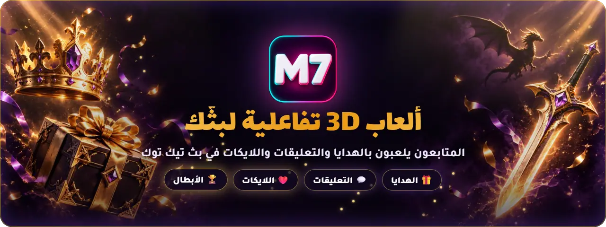</a>

<a href="https://github.com/madomiz11/m7-live/releases/latest/download/M7Live-Setup.exe">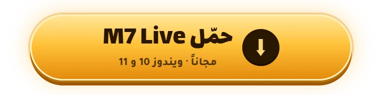</a>

⬇️ <b>تحميل مباشر</b> لآخر نسخة &nbsp;•&nbsp; ويندوز 10 و 11 (64-bit) &nbsp;•&nbsp; يتحدّث البرنامج تلقائيًا بعد ذلك

   

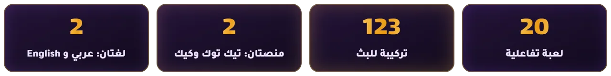

<b><a href="#what">🎯 ما هو</a> &nbsp;•&nbsp; <a href="#new">🔥 الجديد</a> &nbsp;•&nbsp; <a href="#games">🎮 الألعاب</a> &nbsp;•&nbsp; <a href="#overlays">👑 العروض</a> &nbsp;•&nbsp; <a href="#plans">💎 الباقات</a> &nbsp;•&nbsp; <a href="#features">✨ المميزات</a> &nbsp;•&nbsp; <a href="#req">💻 المتطلبات</a> &nbsp;•&nbsp; <a href="#faq">❓ الأسئلة</a> &nbsp;•&nbsp; <a href="#download">⬇️ التحميل</a></b>

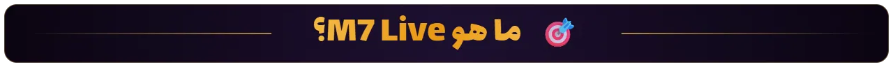

برنامج لويندوز يربط بثّك في تيك توك بألعاب **3D** تعمل على شاشتك. كل هدية أو تعليق أو لايك من المتابعين يُحدث شيئًا داخل اللعبة. **أنت تختار** ما تفعله كل هدية، والمتابعون يتحمّسون لأنهم يرون دعمهم يغيّر اللعبة أمامهم.

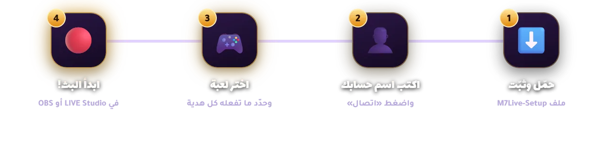

<table>
<tr>
<td align="center" width="25%">🔒 <b>اسم حسابك فقط</b> لا يطلب كلمة مرور تيك توك</td>
<td align="center" width="25%">🧪 <b>وضع التجربة</b> متابعون وهدايا وهمية قبل البث</td>
<td align="center" width="25%">🔄 <b>تحديث تلقائي</b> كل جديد يصلك داخل البرنامج</td>
<td align="center" width="25%">🎛️ <b>أنت المتحكّم</b> كل هدية تفعل ما تختاره</td>
</tr>
</table>

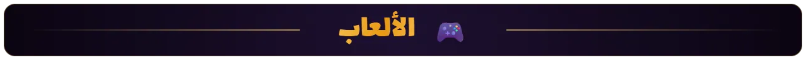

### 🔥 الجديد

<a href="#download">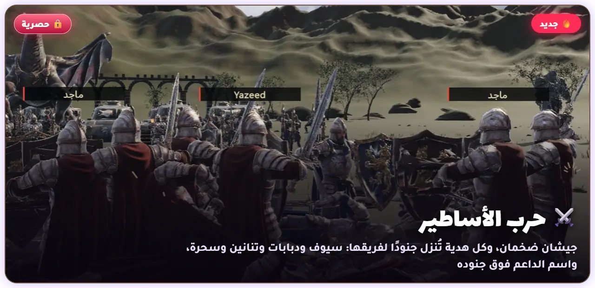</a>

<b>🆕 حرب الأساطير — معركة جيشين بهدايا متابعيك 🔒</b>

<table>
<tr>
<td width="50%">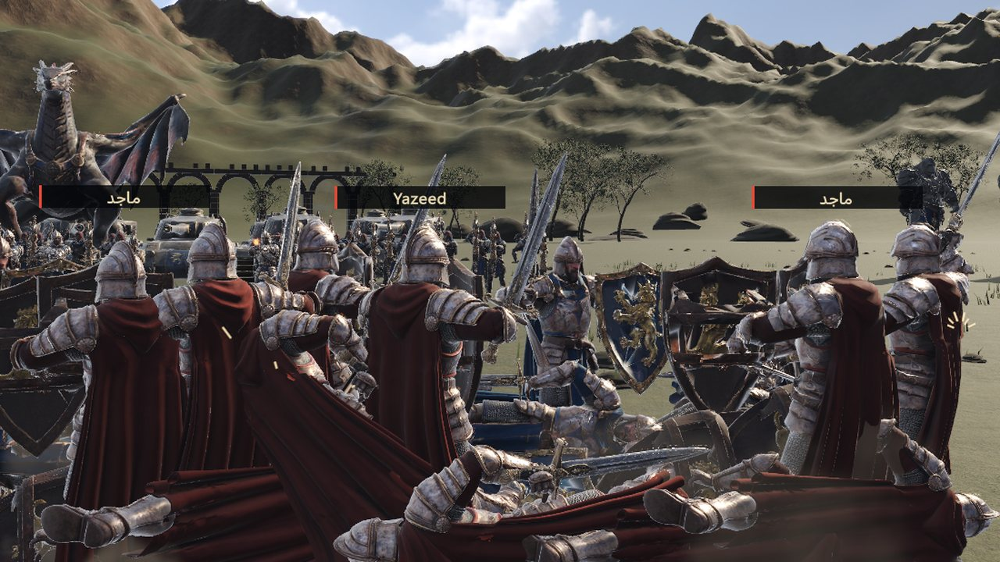 <b>🛡️ فرسان بدروع حقيقية</b> مقاتلون بالسيوف والدروع يتقدّمون نحو الجيش الآخر</td>
<td width="50%">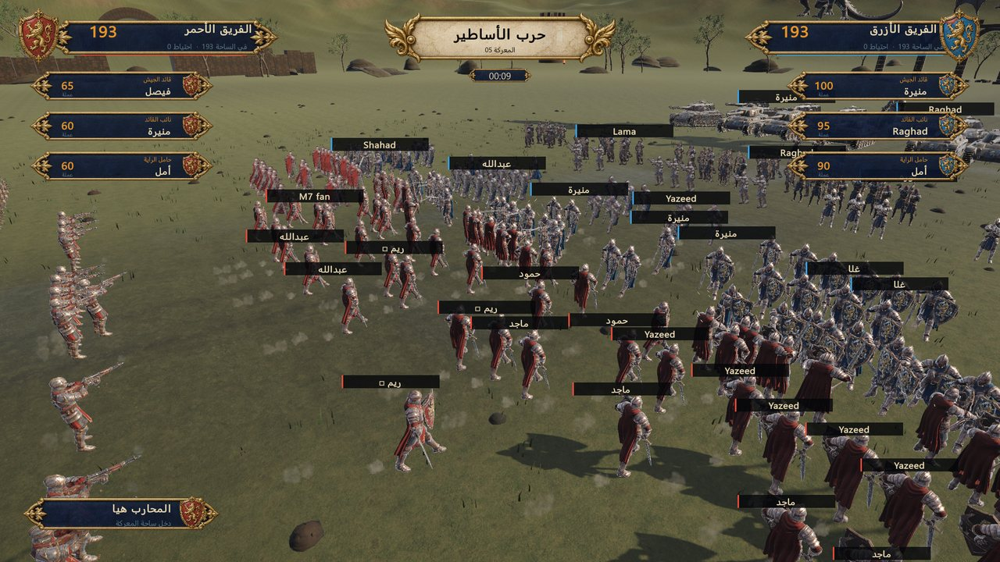 <b>🏷️ اسمك فوق جنودك</b> كل داعم يرى اسمه فوق الجنود الذين أنزلهم، وأكبر الداعمين يصيرون قادة الجيش</td>
</tr>
<tr>
<td width="50%">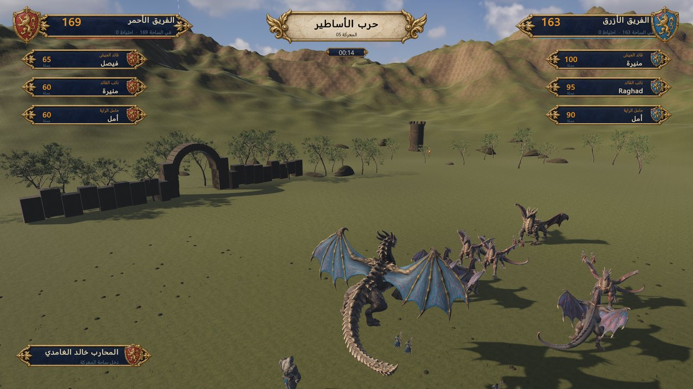 <b>🐉 تنانين وسحرة</b> الهدايا الكبيرة تُنزل تنانين ووحوشًا وسحرة ودبابات</td>
<td width="50%">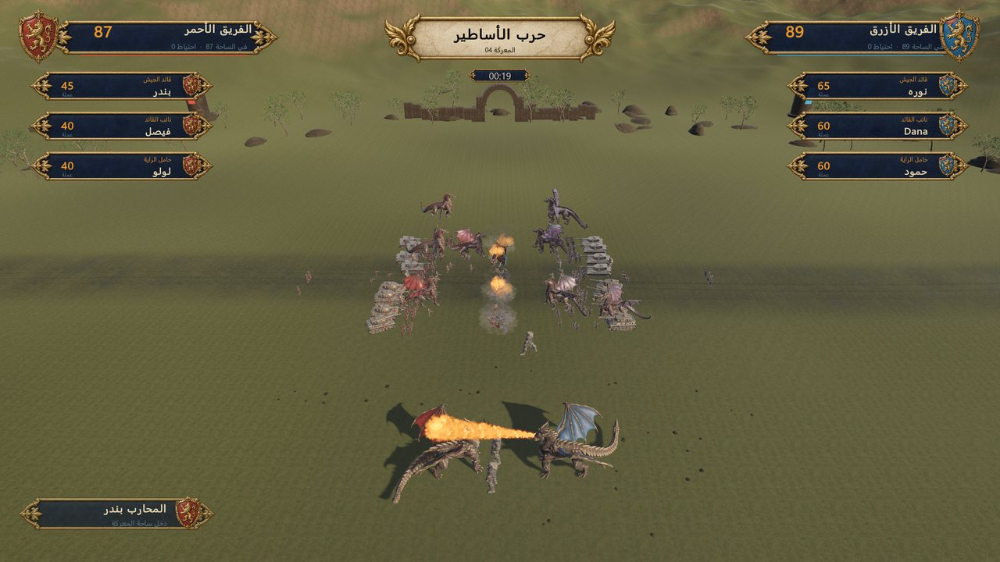 <b>🔥 نار التنين</b> التنين يحرق صفوف العدو، والنتيجة تتغير في لحظة</td>
</tr>
</table>

> 🔒 **لعبة حصرية:** لا تظهر لكل المشتركين، بل تُفتح لمن نختاره. لتطلبها، اضغط زر الاشتراك في أعلى البرنامج وتواصل معنا.
>
> ⚔️ **جيشان وأحد عشر نوعًا من الجنود:** كل هدية تُنزل جنودًا لفريقها: مقاتلين بالسيوف، ورماة، وقنّاصين، ودبابات، ووحوشًا، وتنانين، وسحرة. وأنت تختار ما تفعله كل هدية.

<a href="#download">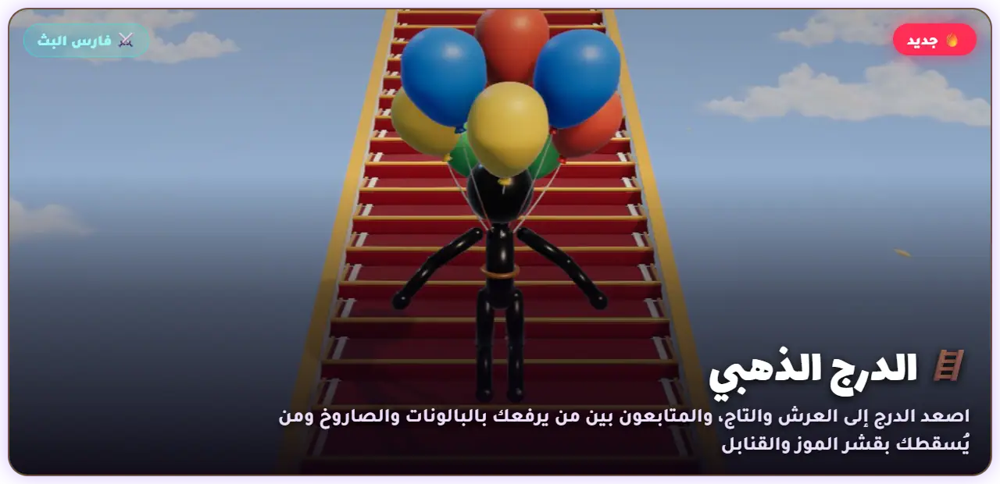</a>

<b>🆕 الدرج الذهبي — اصعد إلى التاج، والمتابعون يقررون</b>

<table>
<tr>
<td width="50%">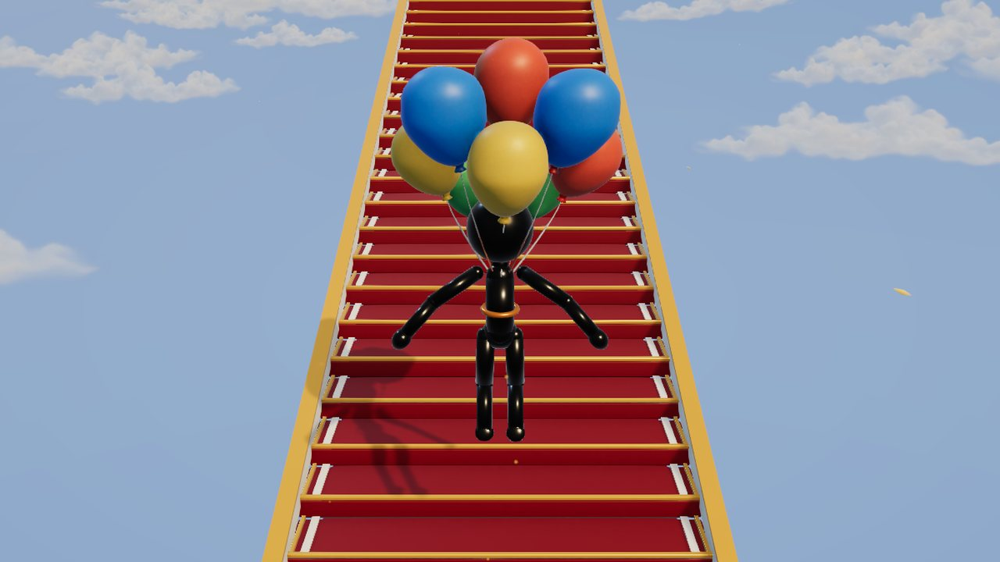 <b>🎈 بالونات ترفعك</b> هدية واحدة تطيّرك درجات إلى الأعلى</td>
<td width="50%">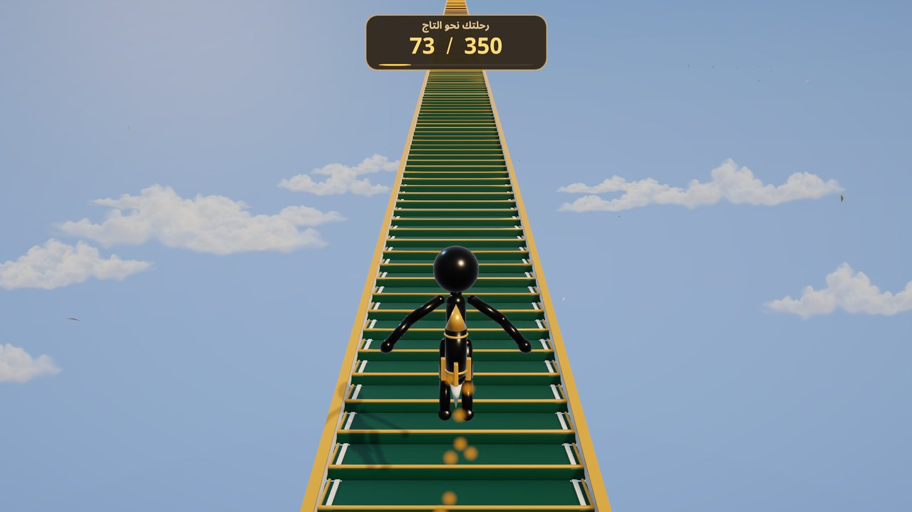 <b>🚀 صاروخ على ظهرك</b> يدفعك بسرعة نحو القمة</td>
</tr>
<tr>
<td width="50%">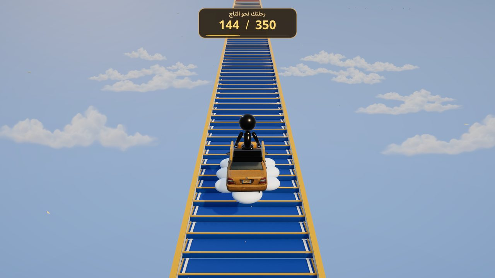 <b>🚕 سيارة طائرة</b> تحملك فوق غيمة إلى الأعلى</td>
<td width="50%">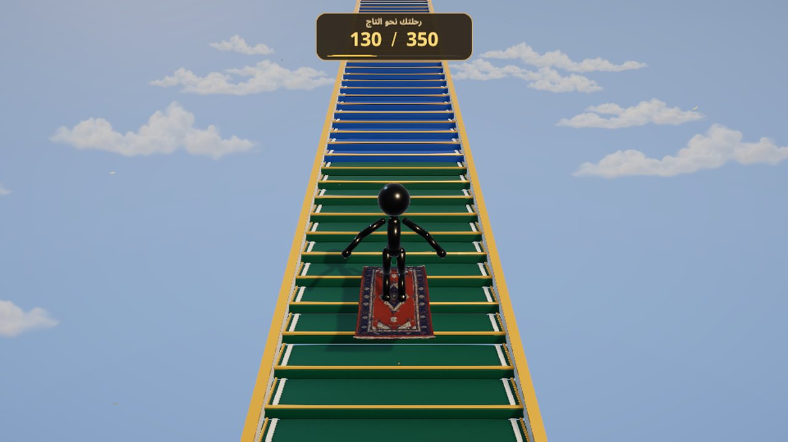 <b>🧞 البساط الطائر</b> يطير بك فوق الدرجات</td>
</tr>
</table>

> 🍌 **وبعض المتابعين ضدك:** قشر الموز والقنابل والكرات الحديدية وموجة الماء تُسقطك إلى الأسفل. فيها 28 أداة، وثلاثون ثيمًا لدول، ومنافسة بين نقاط الفوز والخسارة.

<a href="#download">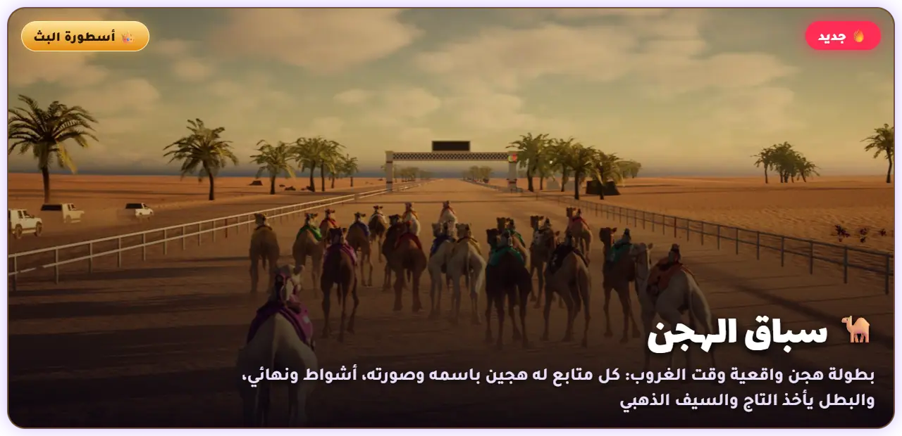</a>

<b>🐪 سباق الهجن — بطولة هجن حقيقية في بثّك</b>

<table>
<tr>
<td width="50%">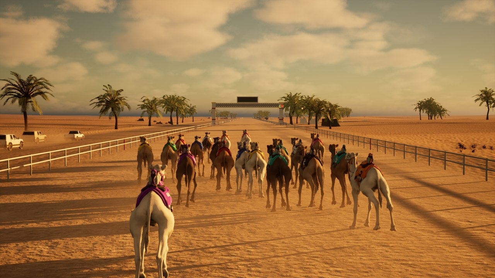 <b>🏜️ مضمار حقيقي وقت الغروب</b> كل متابع يسجّل يأخذ هجينًا، وحتى 20 هجينًا في الشوط</td>
<td width="50%">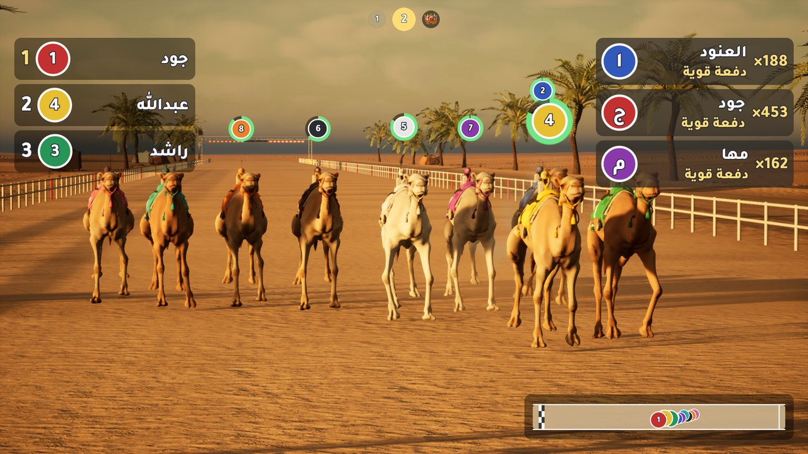 <b>🎁 الهدايا تحرّك السباق</b> الترتيب مباشر، وكل دفعة قوية تظهر باسم صاحبها</td>
</tr>
<tr>
<td width="50%">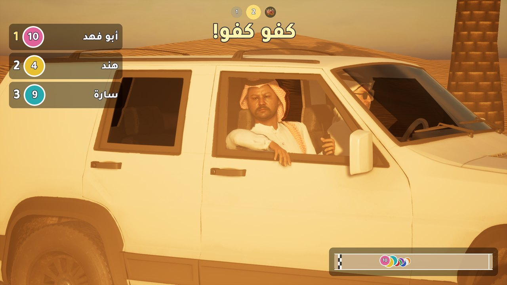 <b>📣 «كفو كفو!»</b> الملّاك بالغترة والعقال يشجّعون من السيارات، وينادون اسم المتصدّر</td>
<td width="50%">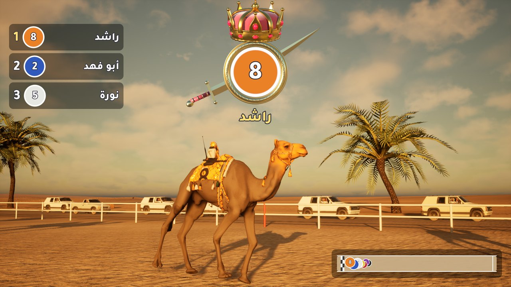 <b>👑 تتويج البطل</b> زعفران على رأس الهجين، والتاج والسيف الذهبي لصاحبه</td>
</tr>
</table>

> 🏆 **بطولة كاملة:** يُفتح التسجيل مرة واحدة، ثم تقسّم القرعة المسجّلين على الأشواط بالتساوي، ويتأهل أول ثلاثة من كل شوط إلى النهائي. حتى 5 أشواط، أي 100 مشارك.
>
> 💧 **الهجن تتعب:** حول صورة كل متابع حلقة طاقة، وعندما يتعب هجينه تظهر قطرة ماء. «شربة ماء» تعيد طاقته، والهدايا تعطيه دفعة.

<a href="#download">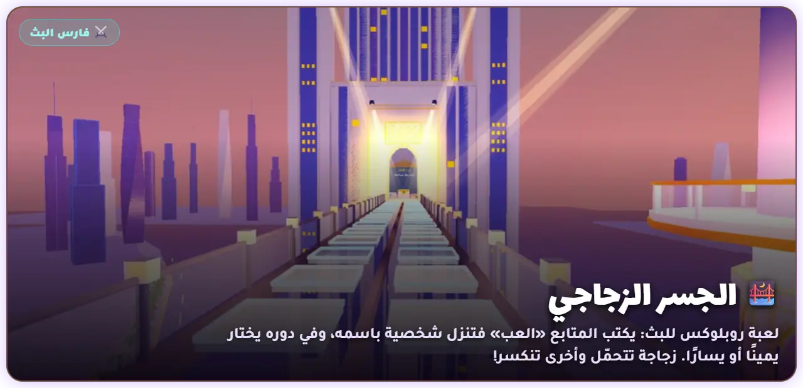</a>

<b>🌉 الجسر الزجاجي — لعبة مشاهدة في بثّك على روبلوكس</b>

<table>
<tr>
<td width="50%">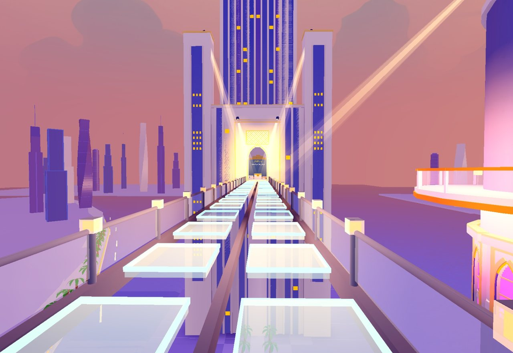 <b>🌉 جسر زجاجي فوق مدينة خليجية</b> في كل صف لوحان من الزجاج: أحدهما يتحمّل والآخر ينكسر</td>
<td width="50%">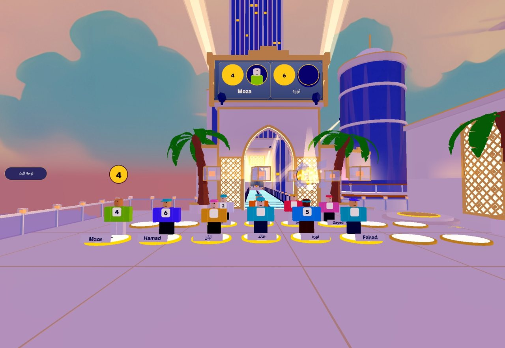 <b>🎁 صناديق الحظ</b> يكتب المتابع «العب» فتنزل شخصية باسمه، ويكشف الصندوق رقمه</td>
</tr>
<tr>
<td width="50%">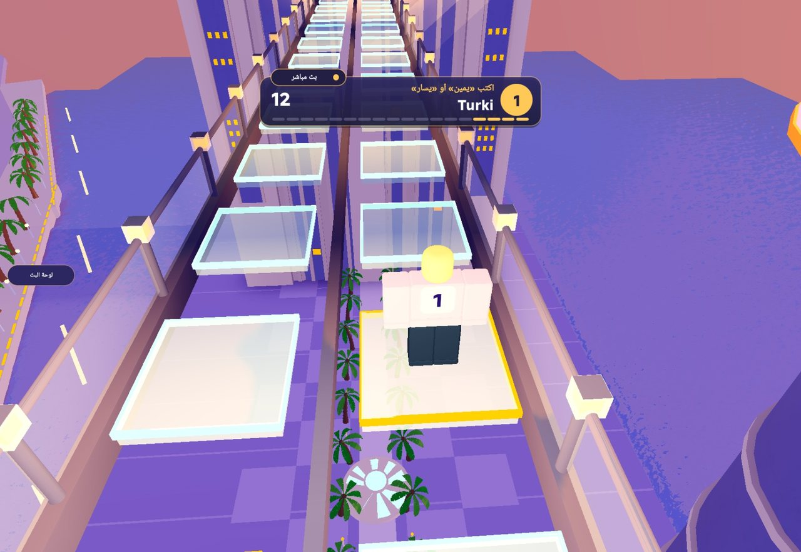 <b>⬅️ يمين أو يسار ➡️</b> يكتب صاحب الدور اختياره في التعليقات، والكاميرا تتابعه</td>
<td width="50%">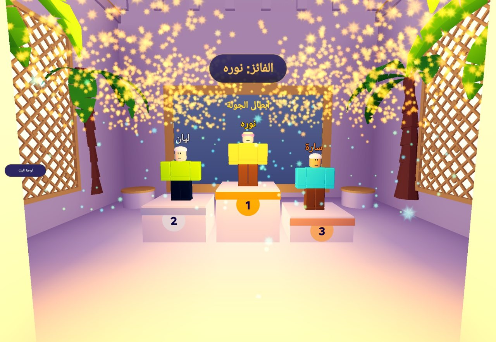 <b>🏆 منصة الأبطال</b> يأخذ الفائز المركز الأول بومضة ذهبية وقصاصات احتفال</td>
</tr>
</table>

> 🎮 **هدايا البث تغيّر اللعب:** تكشف الزجاج الآمن، أو تعطي مظلة، أو تهزّ الجسر، أو تجلب رياحًا وضبابًا، أو تكسر الزجاج. وأنت تختار ما تفعله كل هدية.
>
> 🔒 عندما تربطها ببثّك تنتقل إلى غرفة خاصة بك، فلا يدخل أحد ليخرّب. تحتاج حساب روبلوكس على جهازك.

### 👑 الألعاب الضخمة — تعمل كبرنامج مستقل

<a href="#download">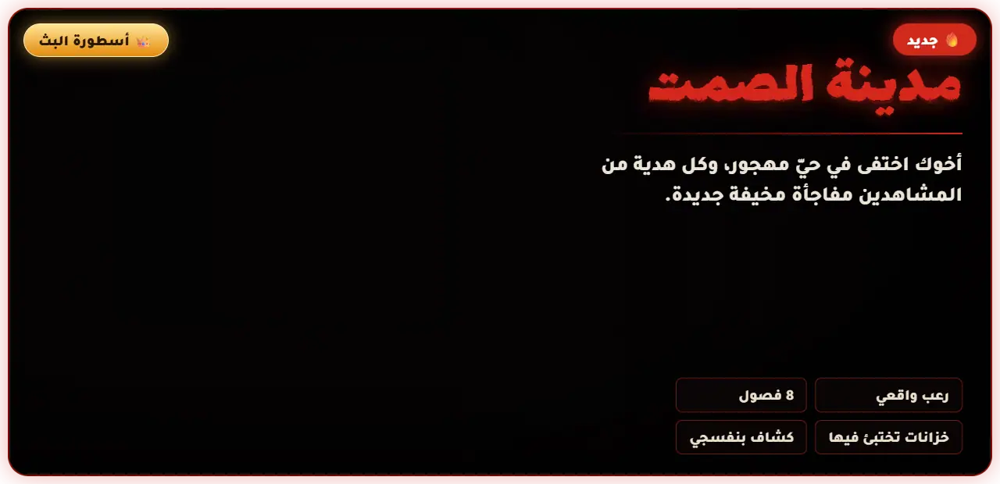</a>

<b>🌑 مدينة الصمت — شاهد الصور</b>

<table>
<tr>
<td width="50%">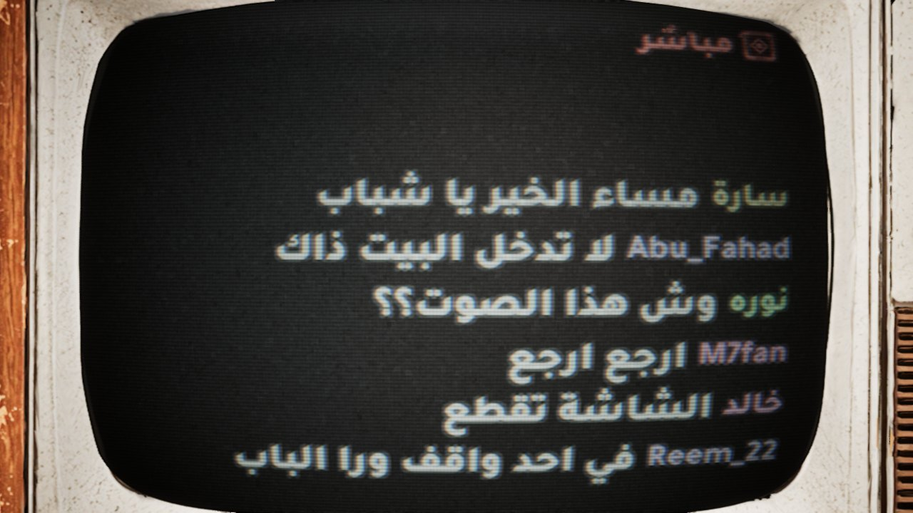 <b>📺 تعليقات المتابعين على التلفزيونات</b> اضغط E لتقترب من الشاشة… وأحيانًا يُكتب لك شيء ليس من المتابعين</td>
<td width="50%">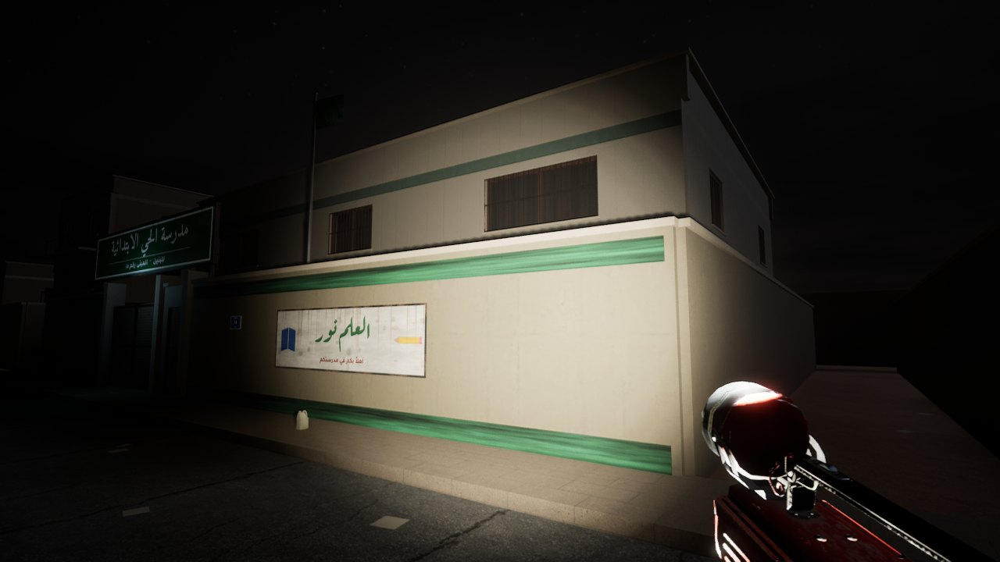 <b>🏫 مدرسة الحي</b> لوحتها الخضراء الكبيرة، وسورها الملوّن، وعبارة «العلم نور» على الجدار</td>
</tr>
<tr>
<td width="50%">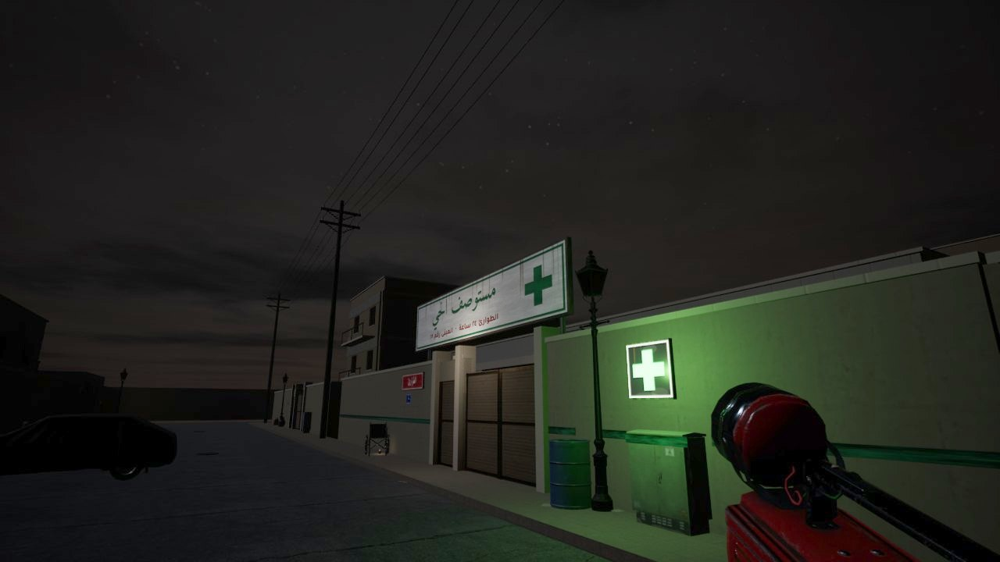 <b>🏥 مستوصف الحي</b> صليب أخضر يضيء في الظلام، وكرسي متحرك متروك عند الجدار</td>
<td width="50%">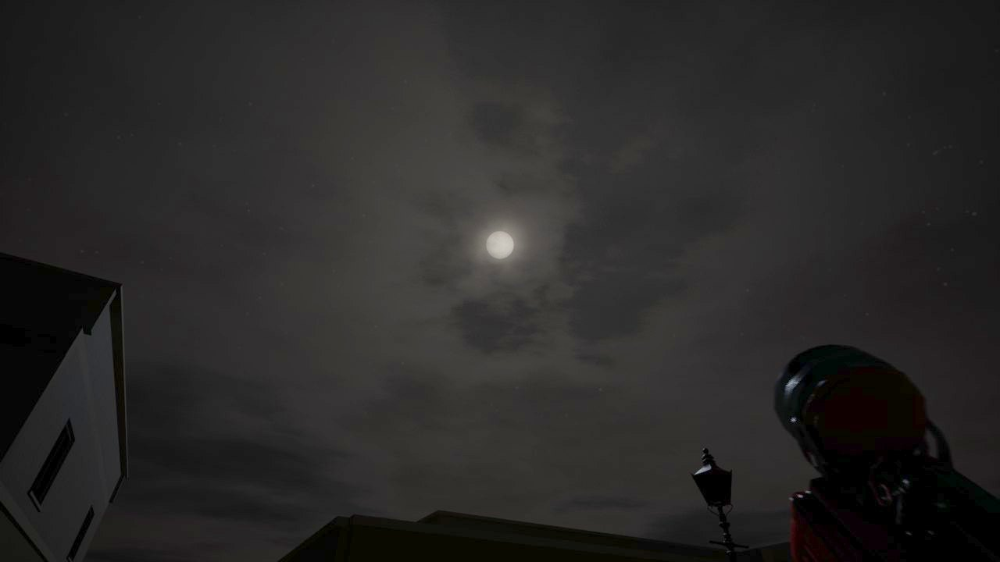 <b>🌫️ سماء ليل حقيقية</b> غيوم ثقيلة تتحرك وقمر شاحب، وتتغيّر مع كل فصل وتضيء مع البرق</td>
</tr>
</table>

> 👹 **لكل وحش حركته:** الأبيض يتجمّد إذا نظرت إليه ثم يدير رأسه نحوك، والهيكل يتشنّج ثم يركض فجأة، والضخم يعرج ويشمّ الهواء ثم يهجم، ووحش التلفزيون يتقطّع كشريط تالف.

<a href="#download">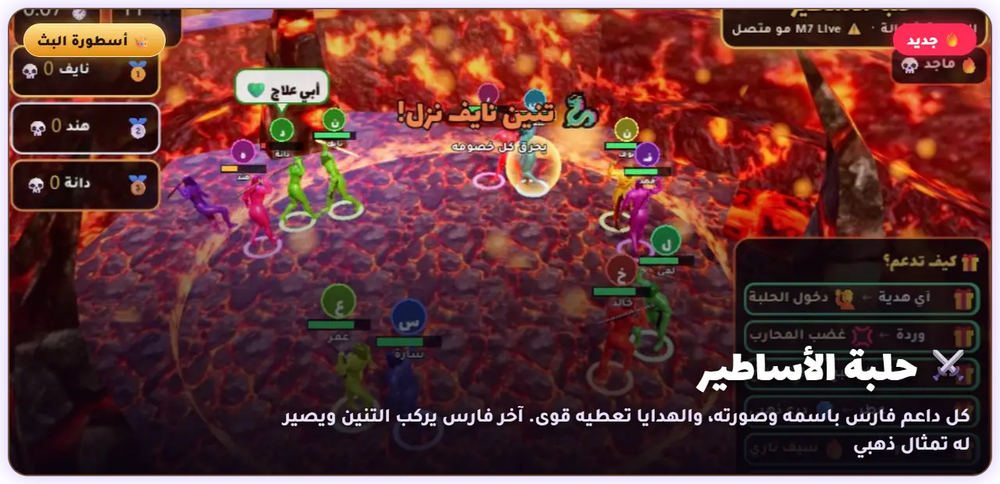</a>

<a href="#download">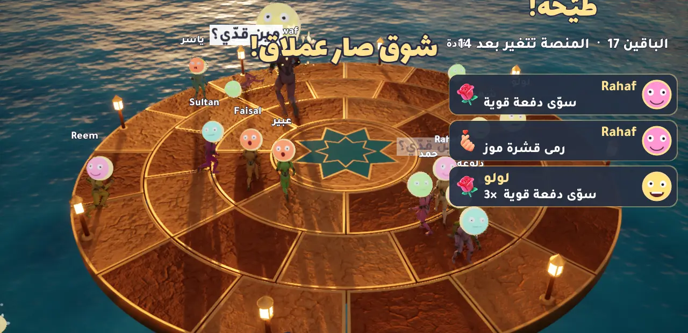</a>

### 🎮 ألعاب البث — داخل البرنامج

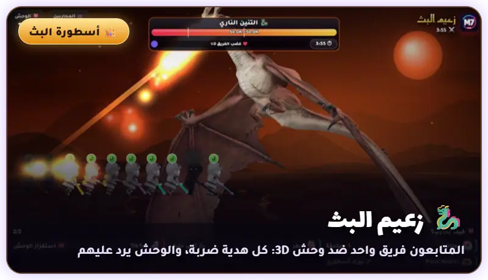
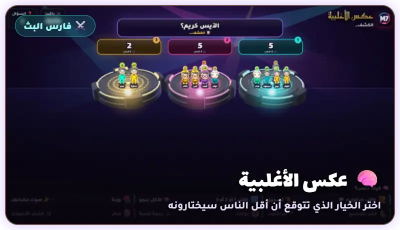

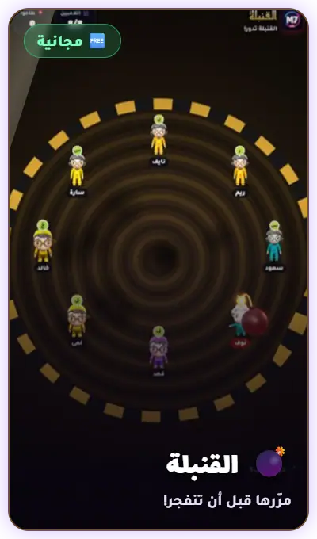
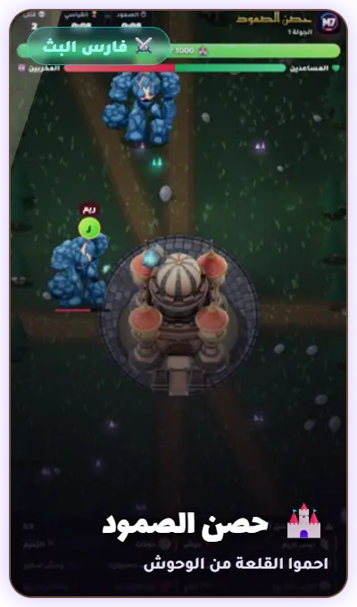
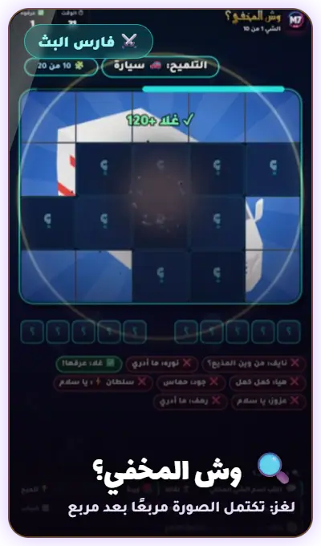
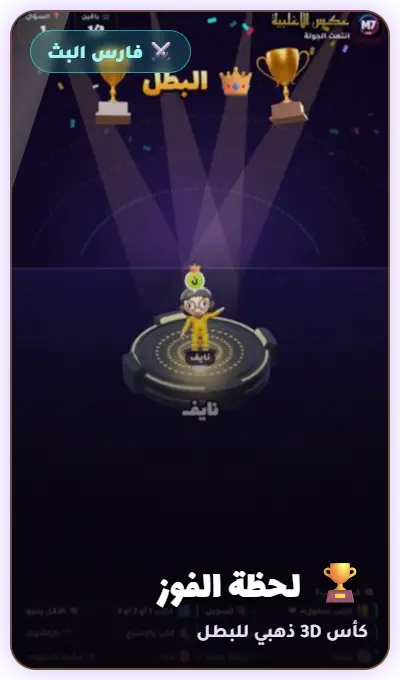

### 🧩 كل الألعاب في لمحة

<table>
<tr>
<td align="center" width="20%">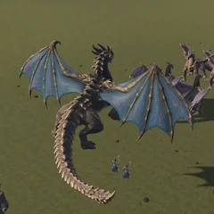 <b>حرب الأساطير</b></td>
<td align="center" width="20%">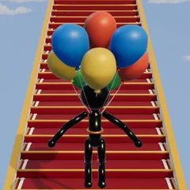 <b>الدرج الذهبي</b></td>
<td align="center" width="20%">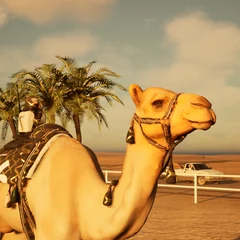 <b>سباق الهجن</b></td>
<td align="center" width="20%">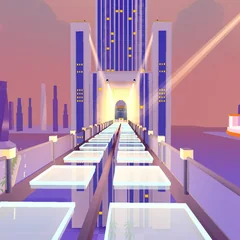 <b>الجسر الزجاجي</b></td>
<td align="center" width="20%">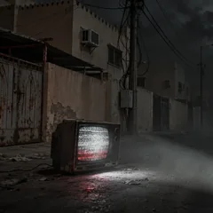 <b>مدينة الصمت</b></td>
</tr>
<tr>
<td align="center" width="20%">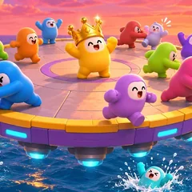 <b>طيّحه!</b></td>
<td align="center" width="20%">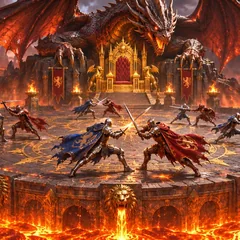 <b>حلبة الأساطير</b></td>
<td align="center" width="20%">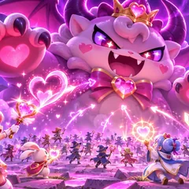 <b>زعيم البث</b></td>
<td align="center" width="20%">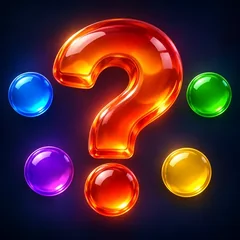 <b>سؤال وجواب</b></td>
<td align="center" width="20%">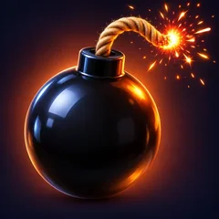 <b>القنبلة</b></td>
</tr>
<tr>
<td align="center" width="20%">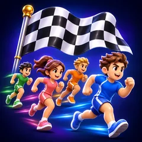 <b>سباق المتابعين</b></td>
<td align="center" width="20%"> <b>حروف</b></td>
<td align="center" width="20%"> <b>رتّب الحروف</b></td>
<td align="center" width="20%"> <b>الكراسي الموسيقية</b></td>
<td align="center" width="20%"> <b>عكس الأغلبية</b></td>
</tr>
<tr>
<td align="center" width="20%"> <b>وش المخفي؟</b></td>
<td align="center" width="20%"> <b>ساحة القتال</b></td>
<td align="center" width="20%"> <b>حصن الصمود</b></td>
<td align="center" width="20%"> <b>عرش أكبر داعم</b></td>
<td align="center" width="20%"> <b>حرب الفريقين</b></td>
</tr>
</table>

<b>📜 كل الألعاب (20 لعبة) — اضغط هنا</b>

| | اللعبة | الفكرة | الباقة |
|:-:|---|---|:-:|
| ⚔️ | **حرب الأساطير** | جيشان ضخمان، وكل هدية تُنزل جنودًا لفريقها | 🔒 |
| 🪜 | **الدرج الذهبي** | اصعد إلى العرش، والمتابعون بين من يرفعك ومن يُسقطك | ⚔️ |
| 🐪 | **سباق الهجن** | بطولة هجن واقعية: أشواط ونهائي، والبطل يأخذ التاج والسيف | 👑 |
| 🌉 | **الجسر الزجاجي** | روبلوكس: اعبر الجسر، فلوح يتحمّل ولوح ينكسر | ⚔️ |
| 🌑 | **مدينة الصمت** | رعب واقعي في حيّ مهجور، والمشاهدون هم من يخيفونك | 👑 |
| 🌊 | **طيّحه!** | منصة فوق البحر: ادفع الجميع، وآخر من يبقى واقفًا يأخذ التاج | 👑 |
| ⚔️ | **حلبة الأساطير** | معركة 3D، وآخر فارس يجلس على العرش | 👑 |
| 👹 | **زعيم البث** | كل المتابعين ضد وحش 3D عملاق | 👑 |
| ❓ | **سؤال وجواب** | اكتب رقم الإجابة، والأسرع يأخذ نقاطًا أكثر | 🆓 |
| 💣 | **القنبلة** | القنبلة تنتقل بينكم، فمرّرها قبل أن تنفجر | 🆓 |
| 🏁 | **سباق المتابعين** | اللايكات والهدايا تسرّعك نحو خط النهاية | 🆓 |
| 🔤 | **حروف** | إنسان، حيوان، نبات، جماد، بلاد | ⚔️ |
| 🔀 | **رتّب الحروف** | أول من يكتب الكلمة الصحيحة يفوز | ⚔️ |
| 🪑 | **الكراسي الموسيقية** | توقفت الموسيقى؟ اكتب رقم الكرسي بسرعة | ⚔️ |
| 🧠 | **عكس الأغلبية** | من يختار مع الأغلبية يسقط | ⚔️ |
| 🔍 | **وش المخفي؟** | لغز: تكتمل الصورة مربعًا بعد مربع | ⚔️ |
| 🗡️ | **ساحة القتال** | آخر من يبقى في الساحة هو البطل | ⚔️ |
| 🏰 | **حصن الصمود** | احموا الحصن، أو خرّبوه! | ⚔️ |
| 👑 | **عرش أكبر داعم** | الملك يحكم حتى يُسقطه أحد بهدية أكبر | ⚔️ |
| 🪢 | **حرب الفريقين** | الهدايا واللايكات تسحب الحبل | ⚔️ |

🆓 مجانية · ⚔️ فارس البث · 👑 أسطورة البث · 🔒 حصرية (تُفتح لمن نختاره)

> 📖 داخل البرنامج: مرّر الفأرة على أي لعبة واضغط «تعليمات» لتقرأ شرحها وطريقة المشاركة فيها.

### 👑 العروض للبث — «المجلس الملكي» و26 شكلًا للإطار

<table>
<tr>
<td width="50%" valign="top">🎨 <b>6 ثيمات و6 تصاميم</b> ذهبي ملكي، وياقوتي، وأزرق، وزمردي، وبنفسجي، وفاتح. وكل عرض شفاف تضعه حيث تشاء</td>
<td width="50%" valign="top">🎬 <b>مشاهد حماسية</b> «تتويج الملك» بتاج مجسّم، و«مشهد الشرف» للهدايا الكبيرة، و«كنز الهدف» في شريط الهدف</td>
</tr>
<tr>
<td width="50%" valign="top">🔗 <b>روابط أونلاين ثابتة</b> تشغّلها من الإعدادات، ثم تلصق الرابط مرة واحدة في OBS أو LIVE Studio، ويعمل حتى من جهاز آخر</td>
<td width="50%" valign="top">🧪 <b>زر «جرّب»</b> تشاهد التتويج والتنبيهات في المعاينة قبل أن تظهر في البث</td>
</tr>
<tr>
<td width="50%" valign="top">🖼️ <b>26 شكلًا للإطار</b> إطار للصورة وإطار للاسم بحركة متصلة: هادئة، وأسطورية، وحماسية. والمؤثرات لا تغطي وجه الداعم أبدًا</td>
<td width="50%" valign="top">🧭 <b>اختيار واضح</b> الأشكال في ثلاث مجموعات، وفوقها بطاقة تشرح حركة الشكل المختار، والمعاينة تتغير فورًا</td>
</tr>
</table>

<b>🪙 الأيقونات الذهبية وإطارات المستويات — اضغط هنا</b>

> 🔑 **كيف أشترك؟** اضغط زر الاشتراك في أعلى البرنامج لتجد طرق التواصل. تحصل على رمز، فتلصقه، وتُفتح الألعاب مباشرة.

| | ألعاب البث | الألعاب الضخمة |
|---|---|---|
| **النظام** | ويندوز 10 أو 11 (64-bit) | ويندوز 10 أو 11 (64-bit) |
| **كرت الشاشة** | أي كرت يشغّل البث | يدعم DirectX 12 (سباق الهجن ومدينة الصمت وطيّحه!) |
| **المساحة** | حجم البرنامج فقط | كل لعبة تُحمَّل وحدها من داخل البرنامج (سباق الهجن نحو 2.1 جيجا، ومدينة الصمت نحو 2.6 جيجا) |
| **الإنترنت** | إنترنت البث العادي | إنترنت سريع للتحميل في المرة الأولى |

<b>📺 كيف أعرض اللعبة في البث؟</b>

**TikTok LIVE Studio**
1. افتح اللعبة من البرنامج.
2. في LIVE Studio اضغط «إضافة مصدر» واختر «التقاط نافذة».
3. اختر نافذة اللعبة (يبدأ اسمها بـ «M7»).

**OBS**
- أضف **Browser Source** وضع فيه رابط اللعبة الذي يظهر لك في البرنامج، أو أضف **Window Capture** لنافذة اللعبة.

> ⌨️ **F11** أو نقرتان بالفأرة على اللعبة = شاشة كاملة، و**Esc** يعيدها.

<b>🐪 كيف أشغّل سباق الهجن؟</b>

1. يجب أن تكون مشتركًا في **أسطورة البث**.
2. افتح «سباق الهجن» من البرنامج واضغط «تحميل» (مرة واحدة فقط، ثم تتحدّث تلقائيًا).
3. من **إعدادات اللعبة** اختر عدد الأشواط ومسافة المضمار ووقت التسجيل والجودة.
4. شغّل اللعبة وصوّر نافذتها في LIVE Studio أو OBS. يسجّل المتابعون بكتابة «هجن» أو بأي هدية.

> 📋 إذا سألك أحد في أي شوط هو، اضغط زر «قائمة الشوط» في البرنامج لتظهر أسماء من يركضون الآن.

<b>🛡️ يقول ويندوز إن الملف غير معروف، فماذا أفعل؟</b>

هذا طبيعي مع البرامج الجديدة. اضغط «مزيد من المعلومات» ثم «تشغيل على أي حال».

<b>🎁 اللعبة لا تستقبل الهدايا</b>

1. تأكد أنك في بث مباشر، وأن اسم الحساب مكتوب بشكل صحيح بدون @.
2. تأكد أن اللعبة المفتوحة هي نفسها المختارة في البرنامج.
3. جرّب «وضع التجربة»: إذا عمل، فالمشكلة في الاتصال بتيك توك وستعود بعد قليل.

<b>⏳ انتهى اشتراكي وأنا في منتصف البث، فهل ينقطع؟</b>

لا. يستمر البث عاديًا حتى تفصل، وبعدها تعود الباقة المجانية حتى تجدّد. وإذا جدّدت قبل انتهاء اشتراكك، يُضاف الوقت الجديد إلى ما تبقّى لك.

<b>🖥️ هل أستطيع تشغيل الألعاب من جهاز آخر؟</b>

نعم، في فارس البث وأسطورة البث. من **الإعدادات ← جهاز ثانٍ** فعّل الخيار وافتح الرابط في الجهاز الآخر (يجب أن يكون على الشبكة نفسها). يبقى البرنامج على جهاز البث، ويعرض الجهاز الآخر الألعاب في OBS.

<b>💻 هل يحتاج جهازًا قويًا؟</b>

أغلب الألعاب خفيفة وتعمل داخل البرنامج، ويكفيها أي جهاز بنظام ويندوز 10 أو 11 يشغّل البث.

أما الألعاب الضخمة (**سباق الهجن** و**مدينة الصمت** و**طيّحه!** و**حلبة الأساطير**) فتعمل في نافذة مستقلة وتُحمَّل مرة واحدة من داخل البرنامج، وكلها عدا حلبة الأساطير تحتاج كرت شاشة يدعم DirectX 12. وإذا تقطّع البث، خفّض الجودة من إعدادات اللعبة.

<b>🌑 كيف أشغّل مدينة الصمت؟</b>

1. يجب أن تكون مشتركًا في **أسطورة البث**.
2. افتح اللعبة من البرنامج واضغط «تحميل» (حجمها كبير، والتحميل مرة واحدة فقط، ثم تتحدّث تلقائيًا).
3. حدّد من **القواعد** الهدية التي تُطلق كل مفاجأة مخيفة، ثم ابدأ الليلة.

تحفظ اللعبة تقدّمك، وتستطيع إكمال الليلة من «أكمل الليلة».

<b>🔄 كيف أحدّث البرنامج؟</b>

يتحدّث البرنامج تلقائيًا. عندما تصدر نسخة جديدة يظهر لك تنبيه داخله، فاضغط «حدّث» وانتهى الأمر.

يبدأ التحميل مباشرة. هل تريد قراءة الجديد؟ <a href="https://github.com/madomiz11/m7-live/releases/latest">ملاحظات آخر تحديث</a>

---

الحقوق والمجسمات

الشخصيات Nick وTani وMiss T (Chibi) من تصميم vj32621 على Sketchfab — CC BY 4.0 · الفارس Kondrashov · الوحوش LasquetiSpice وPhons وBatuhan13 وTim0 وanthonyvanoo · العرش huilling_ng · القنبلة Anshinowara2 · القلعة afun1996 · الكأس Esther3d · المنصة Maks_Art22 · الأكل XOIAL · الحيوانات ranaaunhaider12 وpolyone · السيارات rgsdev · الجمل omarme37 · الدلة CGDELUXE · النباتات gostbento · فارس الأساطير plankusgankus · حلبة الحمم 123umar123 — CC BY 4.0 · التاج الملكي (WirtualneMuzeaMalopolski، CC0) · الأصوات: Kenney وOpenGameArt (CC0) · هتاف الجمهور: Gregor Quendel (CC BY 4.0) · محرك 3D: three.js (MIT) · محرك حلبة الأساطير: Godot Engine (MIT) · محرك طيّحه! ومدينة الصمت وسباق الهجن: Unreal Engine · عالم مدينة الصمت: مجسمات وخامات Poly Haven (CC0) · سباق الهجن: النخل Barsh والخيمة omarme37 (CC BY 4.0)، والصحراء والصخور Poly Haven (CC0) وQuixel Megascans، والسيارات Switchboard Studios، والملّاك Albedewi (Fab)، وصوت البوري 15HPanska_Ruttner_Jan (CC0) · الأيقونات 3D: Microsoft Fluent Emoji (MIT) · الإطارات والميداليات ورسومات العروض: من تصميم صاحب M7 Live · الخطوط Tajawal وLalezar وReem Kufi — SIL OFL · مكتبة tiktok-live-connector — MIT

