

<a href="https://github.com/madomiz11/m7-live/releases/latest">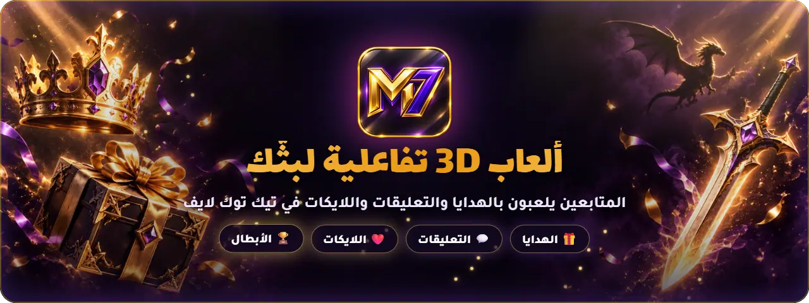</a>

   

## 🎯 وش هو M7 Live؟
برنامج ويندوز يربط بثك في تيك توك بألعاب **3D** تشتغل على شاشتك. كل هدية أو تعليق أو لايك من المتابعين يسوي شي داخل اللعبة. **أنت تختار** وش تسوي كل هدية، والمتابعين يتحمسون لأنهم يشوفون دعمهم يغيّر اللعبة قدامهم.

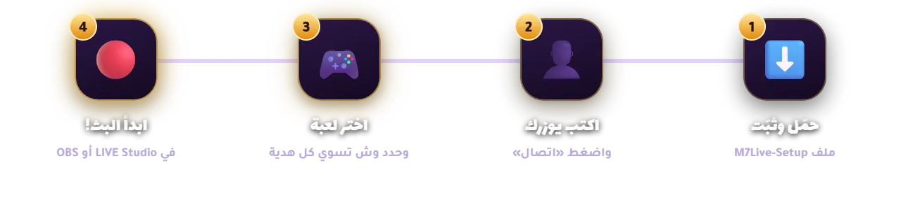

> 💡 تبي تجرب قبل البث؟ شغّل **وضع التجربة** من البرنامج، ويطلع لك متابعين وهدايا وهمية.

## 🎮 الألعاب

<a href="https://github.com/madomiz11/m7-live/releases/latest">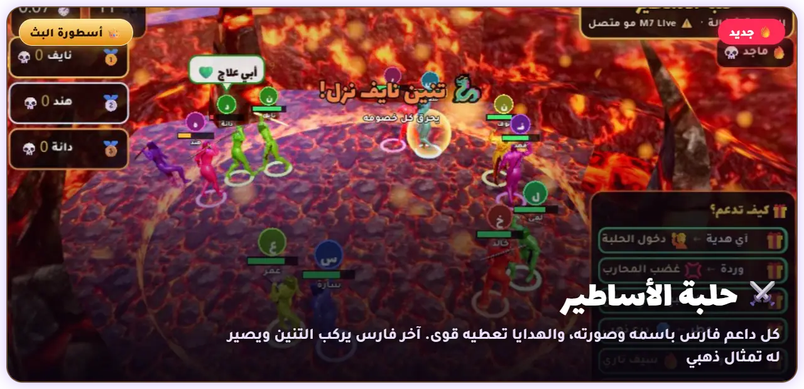</a>

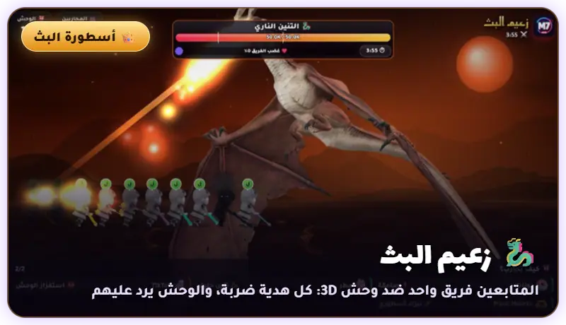
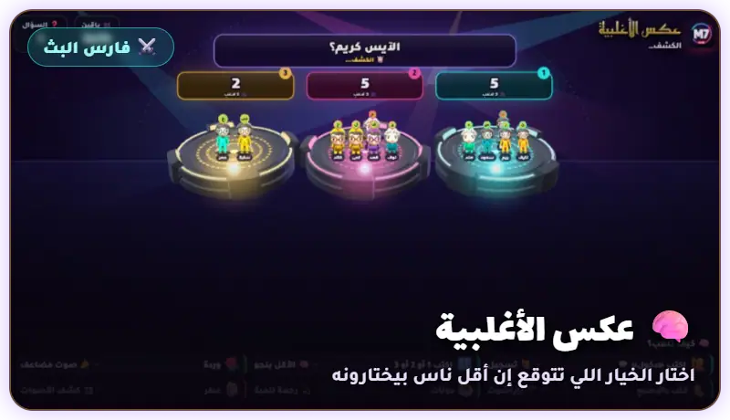

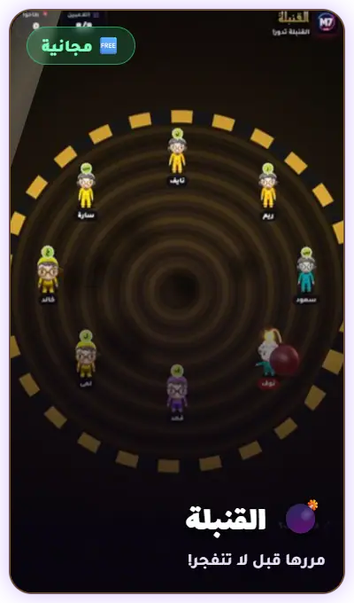
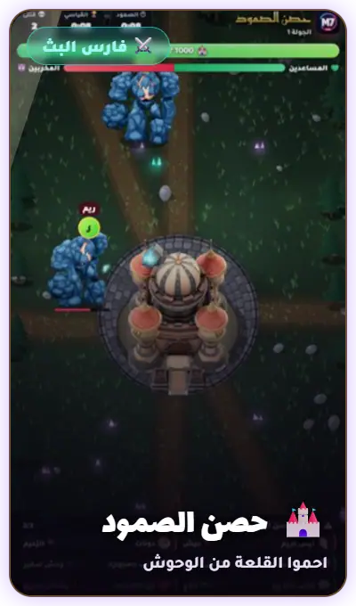
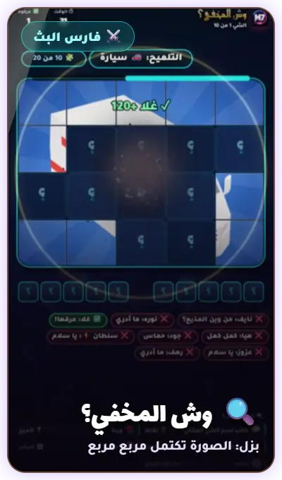
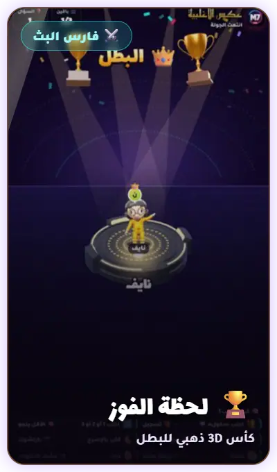

<b>📜 كل الألعاب (14 لعبة) — اضغط هنا</b>

| | اللعبة | الفكرة | الباقة |
|:-:|---|---|:-:|
| ❓ | **سؤال وجواب** | اكتب رقم الجواب، والأسرع ياخذ نقاط أكثر | 🆓 |
| 💣 | **القنبلة** | القنبلة تتنقل بينكم، مرّرها قبل ما تنفجر | 🆓 |
| 🏁 | **سباق المتابعين** | اللايكات والهدايا تسرّعك للخط | 🆓 |
| 🔤 | **حروف** | إنسان، حيوان، نبات، جماد، بلاد | ⚔️ |
| 🔀 | **رتّب الحروف** | أول واحد يكتب الكلمة الصح يفوز | ⚔️ |
| 🪑 | **الكراسي الموسيقية** | توقف الموسيقى؟ اكتب رقم الكرسي بسرعة | ⚔️ |
| 🧠 | **عكس الأغلبية** | اللي مع الأغلبية يطيحون | ⚔️ |
| 🔍 | **وش المخفي؟** | مجسم 3D ينكشف شوي شوي | ⚔️ |
| ⚔️ | **ساحة القتال** | آخر واحد يبقى بالساحة هو البطل | ⚔️ |
| 🏰 | **حصن الصمود** | احموا الحصن، أو خرّبوه! | ⚔️ |
| 👑 | **عرش أكبر داعم** | الملك يحكم لين أحد يطيّحه بهدية أكبر | ⚔️ |
| 🪢 | **حرب الفريقين** | الهدايا واللايكات تسحب الحبل | ⚔️ |
| 👹 | **زعيم البث** | كل المتابعين ضد وحش 3D عملاق | 👑 |
| ⚔️ | **حلبة الأساطير** | معركة 3D، وآخر فارس يصير أسطورة | 👑 |

🆓 مجانية · ⚔️ فارس البث · 👑 أسطورة البث

## 💎 الباقات

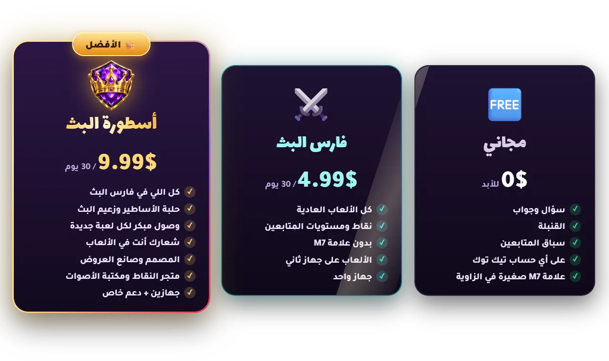

> 🔑 **كيف أشترك؟** اضغط زر الاشتراك فوق داخل البرنامج وتلقى طرق التواصل. تاخذ كود، تلصقه، وتتفعّل الألعاب على طول.

## ✨ مميزات البرنامج

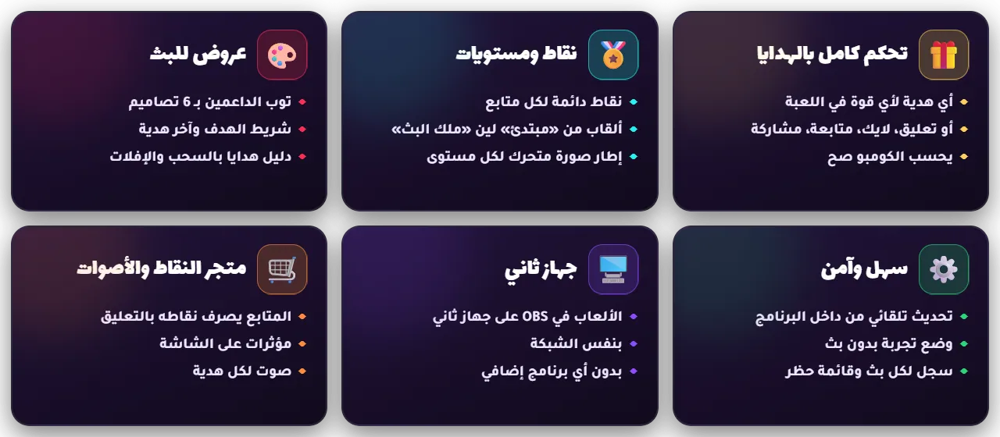

## ❓ أسئلة شائعة

<b>📺 كيف أعرض اللعبة في البث؟</b>

**TikTok LIVE Studio**
1. افتح اللعبة من البرنامج.
2. في LIVE Studio اضغط «إضافة مصدر» واختار «التقاط نافذة».
3. اختار نافذة اللعبة (اسمها يبدأ بـ «M7 Live»).

**OBS**
- أضف **Browser Source** وحط فيه رابط اللعبة اللي يطلع لك في البرنامج، أو أضف **Window Capture** للنافذة.

> ⌨️ **F11** أو ضغطتين بالماوس على اللعبة = شاشة كاملة، و**Esc** يرجعها.

<b>🛡️ ويندوز يقول إن الملف غير معروف، وش أسوي؟</b>

هذا طبيعي مع البرامج الجديدة. اضغط «مزيد من المعلومات» بعدها «تشغيل على أي حال».

<b>🎁 اللعبة ما تستقبل الهدايا</b>

1. تأكد إنك فاتح بث، وإن اليوزر مكتوب صح بدون @.
2. تأكد إن اللعبة اللي فاتحها هي نفسها المختارة في البرنامج.
3. جرّب «وضع التجربة»: لو اشتغل، فالمشكلة في الاتصال بتيك توك وبيرجع بعد شوي.

<b>⏳ خلص اشتراكي وأنا في نص البث، بينقطع؟</b>

لا. البث يكمّل عادي لين تفصل، وبعدها ترجع الباقة المجانية لين تجدّد. ولو جدّدت قبل ما يخلص، الوقت الجديد ينضاف فوق اللي باقي لك.

<b>🖥️ أقدر أشغّل الألعاب من جهاز ثاني؟</b>

إيه، في فارس البث وأسطورة البث. من **الإعدادات ← جهاز ثاني** شغّل الخيار وافتح الرابط في الجهاز الثاني (لازم يكون على نفس الراوتر). البرنامج يبقى على جهاز البث، والجهاز الثاني يعرض الألعاب في OBS.

<b>💻 هل يحتاج جهاز قوي؟</b>

لا. أي جهاز فيه ويندوز 10 أو 11 ويشغّل البث يكفي. الألعاب 3D خفيفة وتشتغل داخل البرنامج.

<b>🔄 كيف أحدّث البرنامج؟</b>

البرنامج يتحدث لحاله. لما تنزل نسخة جديدة يطلع لك تنبيه داخله، اضغط «حدّث» وخلاص.

---

الحقوق والمجسمات

الشخصيات Nick وTani وMiss T (Chibi) من تصميم vj32621 على Sketchfab — CC BY 4.0 · الفارس Kondrashov · الوحوش LasquetiSpice وPhons وBatuhan13 · العرش huilling_ng · القنبلة Anshinowara2 · القلعة afun1996 · الكأس Esther3d · المنصة Maks_Art22 · الأكل XOIAL · الحيوانات ranaaunhaider12 وpolyone · السيارات rgsdev · الجمل omarme37 · الدلة CGDELUXE · النباتات gostbento · فارس الأساطير plankusgankus · حلبة الحمم 123umar123 — CC BY 4.0 · التاج الملكي (WirtualneMuzeaMalopolski، CC0) · محرك 3D: three.js (MIT) · محرك حلبة الأساطير: Godot Engine (MIT) · الأيقونات 3D: Microsoft Fluent Emoji (MIT) · الإطارات والميداليات ورسومات العروض: من تصميم صاحب M7 Live · الخطوط Tajawal وLalezar وReem Kufi — SIL OFL · مكتبة tiktok-live-connector — MIT

